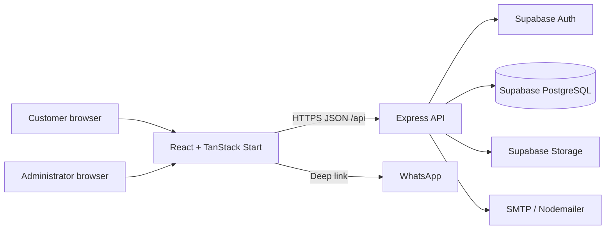

# Architecture and system design

## High-level architecture

Asia Electronics has an SSR-capable React frontend and an Express REST API. TanStack Start and Vite provide the storefront and admin experience. The API runs as Express locally and in Docker, with Vercel adapters for serverless deployment. Supabase provides PostgreSQL, authentication, and object storage.

### Data flow and state

1. The browser loads storefront or admin routes. The browser API client uses `VITE_API_URL`, normally ending in `/api`.
2. Public requests load products, categories, brands, banners, settings, order status, and content from Express.
3. Express delegates email/password identity to Supabase Auth. The frontend stores the returned access token in `localStorage`, verifies it after hydration, and sends it as `Authorization: Bearer <token>`.
4. Express validates the bearer token with Supabase and checks `app_metadata.role` for administrative actions.
5. Express reads and writes PostgreSQL through a service-role Supabase client. Storage holds product assets and public homepage media; it also holds private wholesale attachments.
6. Order and wholesale status changes use SMTP notifications when configured. WhatsApp is a `wa.me` handoff, not a server-side messaging integration.

The client has three main contexts: `AuthProvider` restores sessions, `CartProvider` uses `useReducer` and local storage while enforcing stock caps, and `SettingsProvider` caches public settings. Cart state is browser-only; the server validates SKUs and quantities before creating an order.

### External services

| Service | Role | Notes |
| --- | --- | --- |
| Supabase PostgreSQL | Application data and inventory transactions | Called server-side with the service role. |
| Supabase Auth | Accounts and token validation | Roles live in protected `app_metadata`. |
| Supabase Storage | Product media, homepage media, wholesale files | Homepage assets are public; wholesale files are private. |
| SMTP | Customer status mail | The email service skips delivery when not configured. |
| Vercel | Production hosting | Hosts frontend and serverless API adapters. |

## Data models and schema

The idempotent schema is [backend/src/data/migration.sql](https://github.com/asiaelectronics/asia-electronics/blob/main/backend/src/data/migration.sql). It includes tables, indexes, seeds, and inventory SQL functions.

| Entity | Key fields | Relationship / purpose |
| --- | --- | --- |
| `products` | `id`, `slug`, `sku`, price, stock, JSONB images/specs/attributes | Main catalogue. Its ID is referenced by inventory history. |
| `inventory_history` | product ID, before/after quantities, reason, reference | Auditable stock movements; cascades on product deletion. |
| `categories` | slug, name, image, filter key | Top-level catalogue navigation. |
| `subcategories` | ID, category slug, name, group title | Belongs to a category; duplicate labels per category are blocked. |
| `brands` | slug, name, logo, description | Brand directory and filter source. |
| `orders` | ID, contact data, JSONB items, total, status, inventory flags | Quotation/order record; stock is reserved transactionally. |
| `wholesale_requests` | ID, contact data, details, attachment/quote paths, status | Wholesale quotation workflow. |
| `store_settings` | singleton ID, contact fields, currency, notifications JSONB | Store-wide public/admin settings. |
| `banners` | ID, content, CTA, dates, display order, active flag | Homepage campaigns. |
| `product_analytics_events` | product ID, event type, session ID, timestamp | Product views and add-to-cart reporting. |

`backend/src/data/db.js` translates application camelCase objects and database snake_case rows.

### Inventory consistency

`create_order_with_inventory` validates available stock and creates an order in the same transaction. `adjust_inventory` row-locks the product and records an audit entry. `restore_order_inventory` restores stock at most once when an order becomes cancelled. Keep these database functions in place; separate product updates would introduce race conditions.

## Security and authentication

### Authentication and roles

- Registration creates a confirmed Supabase user with `app_metadata.role = customer`.
- The first admin is created or promoted from `ADMIN_EMAIL` and `ADMIN_PASSWORD` when no admin exists. Rotate these bootstrap credentials after setup.
- `requireAuth` validates a bearer token with Supabase.
- `requireAdmin` requires `app_metadata.role === admin`.
- Browser-side `isAdmin` controls presentation only; middleware is the permission boundary.

### API protections

Before routers run, Express applies strict CORS, trusted-origin checks for unsafe browser methods, a 4 MB body limit, input sanitisation, security headers, and an in-memory per-IP limit of 120 requests per 15 minutes. This rate limiter is process-local; use an edge or shared-store limiter when global limits are needed across multiple serverless instances.

### Secrets and private files

`SUPABASE_SERVICE_KEY`, SMTP passwords, and `WHOLESALE_FILE_LINK_SECRET` are backend-only values. The service key bypasses Supabase RLS and must never be exposed in browser code or committed.

Wholesale files are stored in a private bucket. Their permanent shared URLs contain an HMAC token bound to the request ID and file path. The endpoint verifies that token and redirects to a fresh ten-minute storage URL. Changing the signing secret invalidates existing shared links. Homepage video and banner buckets are public because those assets are displayed on the public store.

The supplied migration disables RLS for application tables because backend access uses the service role. If client-side Supabase database access is later introduced, enable RLS and define least-privilege policies first.
